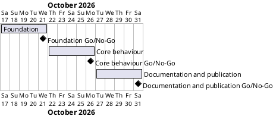

# Monday Motivation Project Plan

## Metadata
| Key | Value |
| --- | --- |
| ID | PP-001 |
| CrossReference | [BC-001], [SA-001], [MIL-001], [MIL-002], [MIL-003] |
| Language | en |
| Domain | it |

## Version History
| Date | Status | Author | Reviewer | Change | Commit |
| --- | --- | --- | --- | --- | --- |
| 2026-10-17 | Deprecated | Jens Tirsvad Nielsen | S01 | Initial version: three gateways | [7d48d63] |
| 2026-10-17 | Accepted | Jens Tirsvad Nielsen | S01 | Accepted by S01 as Product Owner after the autonomous run (stand-in review stays on record) | pending |

---

## Purpose

This plan schedules the three gateways of the Monday Motivation project over the Business Case constraint: delivery within 2 weeks, from 2026-10-17 to 2026-10-31. Each gateway is one branch and one pull request.

## Planning Assumptions

- Week 1 starts 2026-10-17; the plan ends by 2026-10-31, per the Business Case constraints.
- Phases are sized by content, not by equal length: 4, 5 and 5 days.
- S01 owns every gateway and is its approving reviewer; in autonomous mode the AI acts as stand-in for S01 and the review records say so.
- Python is read as 3.13 or later ("greater than 3.13" in the brief).
- The repository is `Tirsvad-Udemy-100-days-of-code/032-monday-motivation`; the brief names its organisation.

## Gateway Schedule

| Gateway | Document | Window | Decision date | Owner | Stories | Main deliverable | Milestone |
| --- | --- | --- | --- | --- | --- | --- | --- |
| Foundation | [MIL-001] | 2026-10-17 to 2026-10-21 | 2026-10-21 | S01 | - | Layout, `pyproject.toml`, `.gitignore`, `constants.py`, `Doxyfile`, smoke test | |
| Core behaviour | [MIL-002] | 2026-10-22 to 2026-10-26 | 2026-10-26 | S01 | - | Working program and `pytest` suite | |
| Documentation and publication | [MIL-003] | 2026-10-27 to 2026-10-31 | 2026-10-31 | S01 | - | README, screenshots, three-language wiki, description and topics | |



## Scope Coverage

| Business Case scope item | Gateway |
| --- | --- |
| Python package under `src/`, tests under `tests/` | MIL-001, MIL-002 |
| `constants.py`, `pyproject.toml`, `.gitignore`, Doxygen comments and `Doxyfile` | MIL-001 (Doxygen comments continue in MIL-002) |
| Functions named after the assignment's steps | MIL-002 |
| README with screenshots | MIL-003 |
| Wiki in English, Danish and Bahasa Malaysia with screenshots | MIL-003 |
| Repository description and topics | MIL-003 |

## Dependencies

```
MIL-001 → MIL-002 → MIL-003
```

A No-Go at a gateway moves the later windows by the rework time; the final date 2026-10-31 is then reviewed with S01.

## Plan Risks

| Risk | Impact | Mitigation |
| --- | --- | --- |
| The git host's wiki cannot be written through the API or git | The wiki would exist only in the repository | MIL-003 task "Publish the wiki" tries the wiki repository first and reports the result; the pages stay in `docs/wiki/` either way |
| The browser used for screenshots is unavailable | No screenshots | A headless Edge or Chrome on the machine is used; the fallback is the built-in browser pane |
| The review of three languages costs time | MIL-003 slips | Danish and Bahasa Malaysia pages follow the English page set exactly and stay short |

## Open Issues

- The brief gives `https://git.tirsystem.com/Tirsvad-Udemy-100_days_of_code`; the existing repository and `origin` are `Tirsvad-Udemy-100-days-of-code/032-monday-motivation`, which this plan uses. S01 can correct it when accepting the plan.
- `GMAIL_TOKEN` is named in the brief but is not present in `.env`; the program reads it from the environment at run time and no test depends on it.
- Criteria 3, 5 and 9 of `QC-LANG-001` stay conditional for the Danish and Bahasa Malaysia wiki pages until a person who reads those languages has checked them (the wiki is not a reviewed artifact; the note is kept in the README of the wiki).

---

[BC-001]: ./business-case.md
[SA-001]: ./stakeholder-analysis.md
[MIL-001]: ./milestones/mil-001-foundation.md
[MIL-002]: ./milestones/mil-002-core.md
[MIL-003]: ./milestones/mil-003-publish.md
[7d48d63]: https://git.tirsystem.com/Tirsvad-Udemy-100-days-of-code/032-monday-motivation/commit/7d48d63e6b73c5d2459bac3bd6720751726d1d6f
